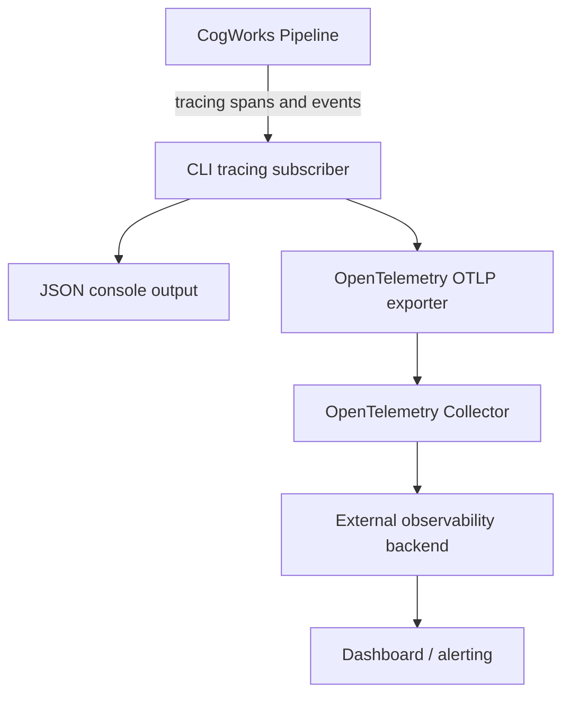

# Operations

This document covers deployment, monitoring, cost management, and operational runbook for CogWorks.

---

## Deployment Model

### CogWorks Binary and Its Dependencies

CogWorks ships as a small, stateless Rust binary. It holds no privilege: no virtualisation, no
host access, no push credential, no model API key.

It does **not** run sandboxes, so it does not need KVM-capable hosts, a container runtime, or a
cluster. Those belong to the stage runner service, which is deployed and scaled separately. This
process makes API calls and writes to GitHub.

**Required runtime dependencies:**

- GitHub API access through the credential-provider interface, scoped to issues, pull requests
  and labels write, with contents and checks **read only**
- The harness source, reachable and resolvable at the version each target repository pins
- A model gateway endpoint (CogWorks holds no provider key)
- The stage runner service, for running stage attempts
- The gate service's check runs, read through the GitHub Checks API
- The write-scope service, for mount plans
- At least one registered domain service for toolchain-specific work (L4)
- Network access to the above

**Owned by the stage runner, not by CogWorks:**

- Sandbox creation and the virtualisation capability it requires
- KVM-capable hosts and their capacity planning
- Push credentials for each identity role
- Working copies inside a sandbox

**Owned by each domain service:**

- Working copy management (git clone, checkout)
- Domain-specific toolchains
- Domain-specific fixtures and test infrastructure

**Not required:**

- No database
- No message queue (L1); a queue consumer is added at L2
- No cache server
- No container runtime in this deployment

**Cloud-neutral.** Nothing in CogWorks depends on a specific cloud. Secrets resolve through the
credential provider over any Vault or KMS; the queue consumer uses a provider-neutral runtime;
telemetry exports over OTLP. On-premises and cloud deployments differ only in configuration.

### Environment Variables

| Variable | Required | Description |
|----------|----------|-------------|
| `COGWORKS_LOG_LEVEL` | No | Log verbosity (default: `info`) |
| `COGWORKS_LOG_FORMAT` | No | Log format: `json` (default) or `text` (for local dev) |
| `COGWORKS_TEMP_DIR` | No | Base directory for temporary files (default: system temp) |
| `COGWORKS_MODEL_GATEWAY_URL` | Yes | The deployment's model gateway endpoint |
| `COGWORKS_MODEL_ID` | Yes | Logical model name the gateway resolves to a concrete provider model |
| `COGWORKS_HARNESS_SOURCE` | Yes | Where the harness is resolved from |
| `COGWORKS_STAGE_RUNNER_URL` | Yes | The stage runner service endpoint |
| `COGWORKS_MOUNT_PLAN_URL` | Yes | The write-scope service endpoint |
| `COGWORKS_GATE_APP_ID` | Yes | Numeric identity of the gate service App whose check runs are trusted |
| `COGWORKS_OTLP_ENDPOINT` | No | OTLP collector endpoint for traces and metrics |
| `COGWORKS_MAX_CONCURRENT_RUNS` | No | Concurrency limit for this process (default: 1) |
| `COGWORKS_PIN_OVERRIDE` | No | Operate against a harness version other than the one a repository pins. For controlled rollout and diagnosis |

**Three variables that must not exist**, in any deployment:

- a model provider API key — the gateway holds those
- a push-capable GitHub token — the stage runner's identity roles hold those
- a webhook HMAC secret — the factory's ingress service holds that

A deployment that sets one of these has a misconfiguration, not a convenience. The composition
root asserts at startup that the resolved GitHub credential carries neither `contents:write` nor
`checks:write`, so the error surfaces immediately rather than in an audit months later.

Credentials are resolved through the credential-provider interface. Authentication and rotation
are provider-owned.

**`COGWORKS_GATE_APP_ID` is load-bearing.** It is the single trust anchor for pass and fail: a
check run from any other author is discarded. Setting it wrong means either no verdict is ever
seen, or — worse — the wrong author's verdicts are trusted. It belongs under the same change
control as a credential.

### Domain Service Registration

Domain services are declared in CogWorks' own process configuration, which describes the host
this process runs on rather than any repository it works on. The configuration carries only
connection information; capabilities are discovered via handshake:

```toml
[[services]]
name = "rust"
transport = "unix"
path = "/tmp/cogworks-rust.sock"
# health_check_timeout_ms = 5000  # optional, default: 5000

[[services]]
name = "kicad"
transport = "http"
url = "http://localhost:9100"
```

On startup, CogWorks performs a handshake with each registered service to discover:

- `domain` (e.g., "firmware", "electrical")
- `capabilities` (which Extension API methods the service supports)
- `artifact_types` (which file extensions the service handles)
- `interface_types` (which cross-domain interface types the service can validate)
- `api_version` (incompatible services are rejected at startup and reported as unavailable)

Discovering rather than declaring means the configuration cannot drift from what a service
actually implements.

### CLI Interface

```
cogworks run --issue <number>        # Process a single work item (one step)        [L1]
cogworks status --issue <number>     # Display current pipeline state (read-only)   [L1]
cogworks cost-report --issue <number> # Display cost report for a run                [L1]
cogworks health                      # Check reachability of every dependency       [L1]
cogworks serve                       # Consume the event queue and loop             [L2]
```

`cogworks run --issue <n>` executes **one step** and exits. Where a stage attempt or its verdict
is still in flight, it reports a waiting state and exits cleanly — it does not block. Driving a
work item to completion means invoking it repeatedly, which is what `serve` does.

`cogworks health` checks the harness source, the model gateway, the stage runner, the write-scope
service, the GitHub API and every registered domain service. Since CogWorks cannot run a stage
without the first five, a health command that only covered domain services would report healthy
on a process that cannot do anything.

**There is no `run-all`.** Choosing which work item to take next, and in what order, belongs to a
separate ordering service. A `--milestone` filter would be a priority decision, and
`REQ-BOUND-008` forbids CogWorks making one. Concurrency within this process is a configuration
limit, not an ordering decision.

### Serve mode (L2)

```
cogworks serve    # Consume normalised events from the factory's event queue
```

Wraps the same step function in a loop driven by queue events. CogWorks does **not** bind an HTTP
server and does not receive GitHub webhooks: ingress, HMAC verification and normalisation belong
to the factory's ingress service. Serve mode exposes health and readiness endpoints only.

---

## Monitoring and Observability

### Structured Logging

All log output is structured JSON. Every log entry includes:

```json
{
  "timestamp": "2026-02-16T14:30:00Z",
  "level": "info",
  "pipeline_id": 42,
  "node": "code_generation",
  "sub_work_item": 5,
  "action": "llm_call",
  "result": "success",
  "duration_ms": 3200,
  "tokens_input": 4500,
  "tokens_output": 1200,
  "message": "Generated code for sub-work-item #5"
}
```

### Illustrative External Analysis Views

The following are possible external analysis views, not named metrics that CogWorks promises to expose. CogWorks records stable pipeline fields through `tracing`: run ID, node ID, event kind (start, completion, retry, or rework), total USD cost at node completion, retry root cause, and rework misalignment type. External systems may derive only measurements supported by the data actually exported.

These are possible questions external operators may investigate, not a CogWorks metric schema or contract. CogWorks records run ID, node ID, event kind, total USD cost at node completion, retry root cause, and rework misalignment type through tracing. External systems may derive only measurements supported by fields actually exported; no named metric series, type, or availability is guaranteed by CogWorks.

### Audit Trail on GitHub

Every pipeline run produces an audit trail posted as comments on the parent work item:

1. **Node entry comment**: When a node begins, post a summary of what will be done.
2. **Node completion comment**: When a node completes, post a summary of what was done (LLM calls made, validations passed, artifacts created).
3. **Failure comment**: When a node fails, post a structured failure report.
4. **Pipeline state comment**: Updated at each node boundary with the full pipeline state JSON (active/completed/pending/failed nodes, traversal counts, cumulative cost).
5. **Cost comment**: On pipeline completion (or failure), post a cost report.

---

## Cost Management

### Budget Configuration

```toml
# CogWorks' own process configuration. This describes the host CogWorks runs on,
# not any repository it works on. Nothing here shapes an agent: stage graphs,
# stage contracts, profiles, prompt templates, output schemas, Context Packs and
# constitutional rules all resolve from the pinned harness.

[budgets]
run_max_tokens = 500000             # Total tokens per run
run_max_cost_dollars = 10.00        # Total cost per run

# Attempt and rework limits are NOT here. They come from the resolved stage
# contract, per stage type and tier, so a repository cannot widen them.

[concurrency]
max_concurrent_runs = 1             # Runs in flight in this process

[labels]
# Label names are configuration. Business logic never depends on a particular
# string, and a work item's tier is NEVER read from a label.
# trigger         = "..."   # human-only; a run starts on no other signal
# awaiting_review = "..."
# hold            = "..."
# cancel          = "..."
# slice           = "..."

[protected_paths]
# CogWorks never generates files matching these patterns, and no mount plan
# makes one writable. The built-in defaults — the pin, the risk map, locked
# tests and their manifest, gate configuration, the Extension API schemas —
# cannot be removed, only extended.
extra = []
```

### Cost Tracking

Costs are tracked in-memory during a pipeline run and written to GitHub on completion:

```
Pipeline #42 Cost Report
========================
Node                     Tokens      Cost
─────────────────────────────────────────
1. Task Classification     2,300    $0.03
2. Architecture           15,000    $0.22
3. Interface Design        8,500    $0.12
4. Planning               12,000    $0.18
5. Code Generation
   SWI #1                 45,000    $0.67
   SWI #2                 38,000    $0.57
   SWI #3                 52,000    $0.78
6. Review
   SWI #1 (4 passes)      20,000    $0.30
   SWI #2 (4 passes)      18,000    $0.27
   SWI #3 (4 passes + 1 remediation)
                           27,000    $0.40
─────────────────────────────────────────
Total                    230,800    $3.44
Budget                   500,000   $10.00
Remaining                269,200    $6.56
```

### Cost Alerts

- **50% consumed**: Informational log entry.
- **75% consumed**: Warning log entry + comment on work item.
- **90% consumed**: Warning log entry + comment on work item with remaining budget.
- **100% consumed**: Pipeline halts. Failure report posted.

---

## Performance Metrics

### Metrics Architecture

CogWorks records pipeline observability fields through structured `tracing` spans and events. The CLI routes these to JSON console output and the configured OpenTelemetry OTLP exporter. CogWorks does not define a separate metric sink, compute a separate metric data-point model, store metrics, aggregate metrics, or provide dashboards.



External systems derive metric views from the span fields available to them. CogWorks operation does not depend on an external metrics backend.

### Metric Categories

The following categories are examples of external operational analysis. They are not a promise that CogWorks exports every listed measurement; queries must be limited to fields actually available from tracing and other external sources.

#### Pipeline Effectiveness Metrics

| Metric | Emitted Data Points | External Aggregation |
|--------|---------------------|---------------------|
| First-pass success rate | Final disposition per pipeline run (merged, rejected, failed, abandoned) | Count merged-on-first-pass / total runs over period |
| Convergence rate | Retry count per code generation cycle | Percentage of runs that converge within retry budget over period |
| Human intervention rate | Whether human gate was triggered per run | Count interventions / total runs over period |
| Safety finding escape rate | Post-merge safety findings detected (if any) | Count escapes / total runs over period |

#### Pipeline Efficiency Metrics

| Metric | Emitted Data Points | External Aggregation |
|--------|---------------------|---------------------|
| Pipeline cycle time | Node start/end timestamps per run | Mean, p50, p95, p99 over period |
| Per-node latency | Wall-clock duration per node per run | Mean/percentile per node type |
| LLM cost per pipeline | Total token usage and cost per run | Mean, trend over period |
| Domain service latency | Per-method invocation timing per run | Mean/percentile per method |
| Retry overhead | Time and tokens spent on retries per run | Retry cost as percentage of total |

#### Pipeline Quality Metrics

| Metric | Emitted Data Points | External Aggregation |
|--------|---------------------|---------------------|
| Gate pass rate on first attempt | Whether a stage passed its gate on attempt one | Rate per stage type, trend |
| Review finding density | Count and severity of review findings per run | Mean per pipeline, trend |
| Remediation success rate | Whether remediation resolved finding per cycle | Success rate over period |
| Cross-domain violation rate | Cross-domain constraint violations per run | Count per run, trend |

#### Pipeline Learning Metrics

| Metric | Emitted Data Points | External Aggregation |
|--------|---------------------|---------------------|
| Failure root cause distribution | Structured root cause category per failure | Category distribution over period |
| Retry root cause concentration | Root cause category per retry | Most common retry causes over period |
| Context Pack effectiveness | Which packs loaded, pipeline outcome | Success rate per pack combination |
| Budget utilization | Actual cost vs budget per run | Utilization distribution |

### Review Cadence

External dashboards should be configured with views for three review cadences:

| Cadence | Focus | Recommended Actions |
|---------|-------|-------------------|
| Weekly | Operational health: failure rate, cycle time anomalies, cost spikes | Investigate failed runs, adjust retry budgets if needed |
| Monthly | Trend analysis: first-pass success trend, cost efficiency, common root causes | Update Context Packs for common failure patterns, adjust scenario thresholds |
| Quarterly | Strategic review: overall effectiveness, domain service performance, process improvement ROI | Revise pipeline configuration, invest in domain service improvements, update improvement backlog |

### Improvement Loop

When metrics indicate degradation in pipeline performance, the following diagnostic flow is recommended:

```
Measure → Detect → Diagnose → Improve → Verify
```

1. **Measure**: CogWorks exports the tracing fields defined by its observability interface; external systems derive supported measurements.
2. **Detect**: External monitoring detects threshold crossings or trend changes (configured in Grafana alerts, Prometheus alertmanager, etc.).
3. **Diagnose**: Use the diagnostic tables below to trace symptom → likely cause → improvement action.
4. **Improve**: Implement the improvement in the harness (Context Pack update, profile or prompt change, stage graph change) or in the domain service, then move the repository's pin to adopt it.
5. **Verify**: Monitor the externally derived measurements supported by exported fields for the next N pipeline runs to confirm improvement.

#### Common Diagnostic Patterns

| Symptom | Likely Cause | Improvement Action |
|---------|-------------|-------------------|
| First-pass success rate declining | Context drift (codebase evolves, Context Packs stale at the pinned version) | Update the packs in the harness and move the pin |
| Retry count increasing for a stage type | Domain service regression, or an output schema the profile no longer satisfies | Investigate domain service logs and the stage's output schema |
| Cycle time increasing without retry increase | Model latency regression, sandbox start-up cost, or larger slices | Check gateway and stage runner latency, review slice decomposition |
| Gate first-pass rate declining for a stage type | Profile or prompt regression at the pinned harness version | Compare against the previous harness version; roll the pin back to confirm before changing thresholds |
| Cost per run increasing steadily | Bundle growth, or more rework attempts per stage | Review the stage contract's input allowlist and the rework counts in the audit trail |
| High rework failure rate | Gate feedback too coarse to act on, or a systemic gap in the contracts | Review the gate's structured output, then the contract the stage was given |
| Finding escapes detected post-merge | Gate coverage gap at that tier, or a tier derived lower than the work warranted | Review the gate configuration for the tier, then `risk-map.yaml` — an under-rated path is the quieter of the two causes |

### Improvement Backlog

Improvements identified through the review cadence process should be tracked as regular GitHub Issues tagged with the `process:improvement` label. This keeps improvement work visible alongside feature work and allows CogWorks pipeline runs to implement process improvements when appropriate.

### OpenTelemetry Export

The CLI configures the OpenTelemetry OTLP exporter endpoint. The collector and downstream backend determine routing, aggregation, retention, dashboards, and alerting. CogWorks has no `[metrics]` sink configuration section.

---

## Operational Runbook

### Harness Cannot Be Resolved

**Symptom**: Every run on a repository halts immediately with a harness error, before any stage
executes.

**Diagnosis**:

1. Read the error. It distinguishes four cases, and the operator action differs for each:
   - **Pin unreadable** — `.factory/pin.yaml` is absent or does not parse
   - **Version not found** — the pin names a harness version that does not resolve
   - **Verification failed** — the resolved content does not match what the pin names
   - **Source unavailable** — the harness source is unreachable
2. For the first three, inspect the pin and the harness version it names. For the fourth, check
   network reachability and the harness source's own status.

**Resolution**:

1. **Pin unreadable**: fix or create the pin by pull request. It is a protected path, so this is a
   human-approved change.
2. **Version not found**: the pin names a withdrawn or mistyped version. Move it to a version that
   exists.
3. **Verification failed**: do **not** work around this. It means the content at that version is
   not what the pin asserts, which is either corruption or tampering. Investigate before moving
   the pin anywhere.
4. **Source unavailable**: transient. Runs resume without intervention once reachability returns.

**Do not** look for a way to proceed without the harness. There is deliberately none: a run that
cannot establish what governs it must not run.

---

### No Stage Graph or Profile for a Repository

**Symptom**: A run halts naming a tier and discipline, or a full resolution key of
`(stage type, discipline, toolchain, tier)`.

**Diagnosis**:

1. Confirm the derived tier. It comes from `risk-map.yaml` over the affected paths, raise-only — a
   repository recently raised to a higher tier is the common cause.
2. Check whether the resolved harness version covers that `(tier, discipline)` pair, and that
   discipline pack covers the detected toolchain.

**Resolution**:

1. Add the missing graph or profile to the harness discipline pack, release a version, and move
   the repository's pin.
2. **Do not** lower the tier in `risk-map.yaml` to reach a graph that exists. That reduces the
   rigour applied to the work in order to make a tooling gap go away, and the tier is raise-only
   precisely to make this hard to do accidentally.

---

### Run Waiting on a Verdict

**Symptom**: A run reports a waiting state across several invocations. Nothing fails; nothing
advances.

**Diagnosis**:

1. Identify what it is waiting on from the waiting reason: an attempt in flight, or a verdict not
   yet published.
2. If waiting on a verdict, check whether a gate check run exists for the attempt's commit SHA.
3. If a check run exists and looks successful but the run still waits, **check its authoring App
   identity against `COGWORKS_GATE_APP_ID`**. A check run from any other author is discarded
   entirely, which is correct behaviour that looks like a hang.
4. Check the gate service's own health.

**Resolution**:

1. Gate service down or backed up: wait. Runs resume automatically; nothing is lost, because
   position is reconstructed from GitHub.
2. Check run from an unexpected author: either `COGWORKS_GATE_APP_ID` is wrong, or something other
   than the gate service is publishing check runs on factory repositories. The second is a
   security concern, not a configuration one — investigate before changing the setting.
3. **Never** work around a missing verdict by treating the stage as passed. There is no mechanism
   to do so, and adding one would remove the only independent check in the system.

---

### Stage Attempt Never Completes

**Symptom**: An attempt was accepted by the stage runner, but no completion is observable in
GitHub state.

**Diagnosis**:

1. Check the stage runner's status and whether the attempt is still running there.
2. Check whether the expected branch exists and carries commits.
3. Check the stage contract's wall-clock limit against how long the attempt has been in flight.

**Resolution**:

1. After the contract's wall-clock limit, the attempt is treated as failed and the rework and
   escalation policy applies. A retry requests a **new** sandbox; nothing is recovered from the
   lost one.
2. If attempts routinely time out for one stage type, the contract's limit is probably wrong for
   the work. Fix it in the harness rather than raising a global timeout.

---

### Oracle Dispute Raised

**Symptom**: An `implement` stage has recorded a dispute instead of completing, naming a locked
test and its reasoning.

**Diagnosis**:

1. Read the dispute. The agent is asserting the locked test is wrong — testing behaviour the
   specification does not require, or asserting something impossible.
2. Compare the test against the slice and the contracts. This is a judgement a human has to make;
   it is why the path exists.

**Resolution**:

1. **If the test is wrong**: fix it through the oracle stage or a human pull request to the locked
   test paths. Then re-run the slice.
2. **If the test is right**: reject the dispute with a comment. The implementation needs to
   satisfy it.
3. **Never** resolve a dispute by letting the build stage edit the locked test. There is no
   mechanism for it, and an escape hatch that permits a justified edit is indistinguishable from
   one that permits deleting an inconvenient test.

---

### Graph Drift Escalation on Resume

**Symptom**: A run escalates with a graph-drift reason. No stage executes.

**Diagnosis**:

1. The resolved graph's hash differs from the one recorded when the run started. Either the
   repository's pin moved mid-run, or the harness content at that pin changed.
2. Check the pin's recent history and the harness version's content.

**Resolution**:

1. **Pin moved deliberately**: restart the run so it begins coherently under the new graph. Per-stage
   state from the old graph has no defined meaning against a new one, which is why it escalates
   rather than resuming.
2. **Pin did not move**: the content at a fixed version changed, which should be impossible where
   resolution is content-addressed. Treat as THREAT-015 and investigate before restarting.

---

### Credential Wider Than Required

**Symptom**: The process fails at startup asserting that the resolved GitHub credential carries
`contents:write` or `checks:write`.

**Diagnosis**: The credential has been granted push or check-run capability. This is a
misconfiguration, not a convenience: the architecture depends on CogWorks being unable to push
code or author a verdict.

**Resolution**:

1. Narrow the credential to issues, pull requests and labels write, with contents and checks read
   only.
2. **Do not** disable the assertion. It exists because a credential that is too wide is invisible
   in normal operation — everything works, and the blast radius of a compromise is silently much
   larger. Failing at startup is the only point at which this is cheap to notice.

---

### Domain Service Unavailable

**Symptom**: Pipeline fails with "domain service unreachable" or health check failure during pre-flight.

**Diagnosis**:

1. Run `cogworks health <service-name>` to check the specific domain service.
2. Verify the domain service process is running (`ps`, `systemctl status`, etc.).
3. Check the configured socket path or URL in CogWorks' process configuration.
4. Check domain service logs for crash or startup failure.

**Resolution**:

1. Restart the domain service process.
2. Verify the socket/port is not in use by another process.
3. If the service was never started, start it with the appropriate command for that domain.
4. Re-invoke: `cogworks run --issue <number>`.

---

### Domain Service Health Check Failure

**Symptom**: `cogworks health` returns unhealthy for a service, or pipeline logs show "version mismatch" or "missing capabilities".

**Diagnosis**:

1. Run `cogworks health <service-name>` — check reported version and capabilities.
2. Compare reported Extension API version against CogWorks' required version.
3. Check which capabilities the pipeline requires vs. what the service reports.

**Resolution**:

1. If version mismatch: update the domain service to a compatible Extension API version.
2. If missing capabilities: the domain service may not support all operations CogWorks needs. Either update the domain service or limit work items to operations it supports.
3. After updating, verify with `cogworks health <service-name>`.

---

### Interface Registry Validation Failure

**Symptom**: Pipeline fails during architecture or review node with "interface registry validation error".

**Diagnosis**:

1. Check the error message — it will identify the specific TOML file and issue (schema error, conflict, unknown domain).
2. Review the interface registry directory in the repository's specification paths.
3. Validate TOML syntax with a standalone TOML validator.

**Resolution**:

1. If schema error: fix the TOML file to match the interface definition schema.
2. If parameter conflict: resolve conflicting definitions across files for the same interface parameter.
3. If unknown domain: either register the missing domain service in CogWorks' process configuration or remove the interface definition referencing it.
4. Re-invoke: `cogworks run --issue <number>`.

---

### Pipeline is Stuck (Processing Lock)

**Symptom**: Work item has `cogworks:processing` label but no progress.

**Diagnosis**:

1. Check the timestamp comment associated with the processing label.
2. If > 30 minutes old, the previous invocation likely crashed.

**Resolution**:

1. Remove `cogworks:processing` label.
2. Re-invoke: `cogworks run --issue <number>`.
3. The system will read GitHub state and resume from the last completed step.

---

### Pipeline Failed

**Symptom**: Work item has `cogworks:node:failed` label.

**Diagnosis**:

1. Read the failure comment on the work item.
2. Check the node and specific error.

**Resolution by failure type**:

| Failure | Resolution |
|---------|-----------|
| Retry budget exceeded | Review the error summary. Modify the sub-work-item description or interfaces to be clearer. Re-trigger. |
| Cost budget exceeded | Increase budget in config if the work is legitimate. Consider breaking into smaller work items. |
| Scope threshold exceeded | Review the scope estimate. Confirm or reject by commenting and removing the failed label. |
| Configuration error | Fix CogWorks' process configuration and restart. |
| GitHub API error | Check token permissions and rate limits. Re-trigger. |
| Model gateway error | Check gateway reachability and status. Re-trigger. There is no API key here to check. |

---

### Sub-Work-Item PR Rejected

**Symptom**: A sub-work-item PR was closed or changes requested.

**Resolution**:

1. Address review comments on the PR (or close it).
2. Apply `cogworks:status:pending` label to the sub-work-item issue.
3. Re-invoke: `cogworks run --issue <parent-number>`.
4. The system will detect the pending sub-work-item and re-generate code incorporating the review feedback.

---

### Rate Limit Exhaustion

**Symptom**: CogWorks logs show rate limit warnings or the CLI exits with a rate-limit error.

**Diagnosis**:

1. Check `X-RateLimit-Reset` time in the logs.
2. Determine if other tools are sharing the same token.

**Resolution**:

1. Wait for rate limit reset.
2. If recurring, use a dedicated GitHub App installation token for CogWorks.
3. Review pipeline for unnecessary API calls.

---

### Model Gateway Throttling

**Symptom**: CogWorks logs show LLM rate limit throttling warnings, or the CLI exits with a rate-limit halt code. The `cogworks_llm_rate_limit_throttle_seconds` metric shows high values.

**Diagnosis**:

1. Check structured logs for `retry-after` values and provider name.
2. Determine if multiple CogWorks instances or other tools are sharing the same API key.
3. Check whether parallel nodes are compounding the request rate.

**Resolution**:

1. Wait. A throttling response from the gateway is retriable, and the run resumes on a later
   invocation without intervention.
2. If recurring, reduce `max_concurrent_runs` in this process's configuration to lower the
   request rate.
3. **Escalate to the gateway operator.** The gateway holds the provider credentials and sees all
   factory traffic, so it is the only place where quota can be raised or allocation between
   services adjusted. CogWorks cannot fix a factory-wide quota problem by tuning itself, and
   per-process throttling here would be blind to the other processes sharing the same quota.

---

### Semantic Stalling

**Symptom**: A sub-work-item escalates with a "semantic stalling" report, indicating the LLM produced different code on each retry but consistently hit the same error category.

**Diagnosis**:

1. Read the stalling report — it identifies the recurring error category and lists all attempts.
2. Check whether the error category points to a specification issue (e.g., the spec asks for something the target language/framework cannot express).
3. Review the interface definitions and specification for ambiguity.

**Resolution**:

1. Clarify the specification or interface definitions to address the root cause of the recurring error.
2. If the error is a domain constraint that the LLM consistently misunderstands, add explicit guidance in the prompt templates or Context Pack.
3. Re-trigger the pipeline after making specification changes.

---

### LLM Cost Unexpectedly High

**Symptom**: Cost report shows high token usage.

**Diagnosis**:

1. Check per-node breakdown. Which node consumed the most tokens?
2. Check retry counts. High retries indicate the LLM is struggling with the task.
3. Check context sizes. Large context = more input tokens per call.

**Resolution**:

1. If retries are high: improve prompt templates, clarify interfaces/specifications.
2. If context is large: review what's being included. Consider more targeted context assembly.
3. If the work item is inherently complex: break it into smaller work items.
4. Consider using a cheaper model for high-retry nodes (code generation iterations).

---

### Injection Detected (Hold State)

**Symptom**: Work item has `cogworks:hold` label and audit trail shows `INJECTION_DETECTED` event.

**Diagnosis**:

1. Read the failure comment on the work item — it will include the source document and offending text.
2. Review the flagged content critically: is it a genuine injection attempt or a false positive?
3. Common false positives: security test pseudocode, examples of injection patterns in training documentation, or technical content that uses imperative language.

**Resolution**:

- **If genuine injection attempt**: Mark the work item as contaminated. Remove the configured readiness signal (default label mapping: `cogworks:run`) and add a comment documenting the contamination. Do not remove the `cogworks:hold` label. Notify the team about the injection attempt origin.
- **If false positive**: Remove the `cogworks:hold` label with a comment documenting why the flagged content is legitimate (e.g., "False positive — security test pseudocode, not an injection attempt"). Include the reviewer's name. Re-invoke: `cogworks run --issue <number>`.

**Alert recommendation**: External monitoring may alert on an exported `INJECTION_DETECTED` event if the configured tracing pipeline retains and exposes that event. CogWorks does not guarantee a dedicated metric series for it.

---

### Scope Underspecified or Ambiguous

**Symptom**: Pipeline fails with `SCOPE_UNDERSPECIFIED` or `SCOPE_AMBIGUOUS` event in audit trail.

**Diagnosis**:

1. Read the event details — it will identify the missing capability or ambiguous specification section.
2. `SCOPE_UNDERSPECIFIED`: The work item requires a capability not in the approved specification or interface document.
3. `SCOPE_AMBIGUOUS`: A safety-affecting specification section is ambiguous and cannot be implemented without clarification.

**Resolution**:

1. Review the specification and interface documents.
2. For `SCOPE_UNDERSPECIFIED`: Update the specification PR or interface document to explicitly include the needed capability.
3. For `SCOPE_AMBIGUOUS`: Clarify the ambiguous specification section by updating the spec PR with a more explicit definition.
4. After updating the specification, the Interface Design node may need to be re-run to update the interface document.
5. Re-invoke: `cogworks run --issue <number>`.

---

### Context Pack Not Loading

**Symptom**: LLM is generating code that ignores domain-specific safety patterns or best practices. Audit trail shows zero packs loaded for a work item that should match a pack.

**Diagnosis**:

1. Check the audit trail for pack loading events — it will list which packs were evaluated and why each did or did not match.
2. Check the resolved harness version, and that it contains the expected pack. A pack added to
   the harness reaches a repository only when its pin moves.
3. Check the pack's trigger definition against the stage's tier, discipline, stage type and
   detected toolchain.
4. Check the stage contract's input allowlist. A pack that matched its trigger is still absent
   from the bundle if the allowlist does not admit Context Packs — and this is the more common
   cause, because it looks identical from the agent's output.

**Resolution**:

1. If the pack is missing from the resolved harness: add it in the harness, release a version,
   and move the repository's pin.
2. If the trigger definition is wrong: fix it in the harness and move the pin.
3. If the allowlist does not admit packs: fix the stage contract in the harness.
4. If the tier is wrong: check `risk-map.yaml`, which is where tier comes from. A label will not
   change it.

---
